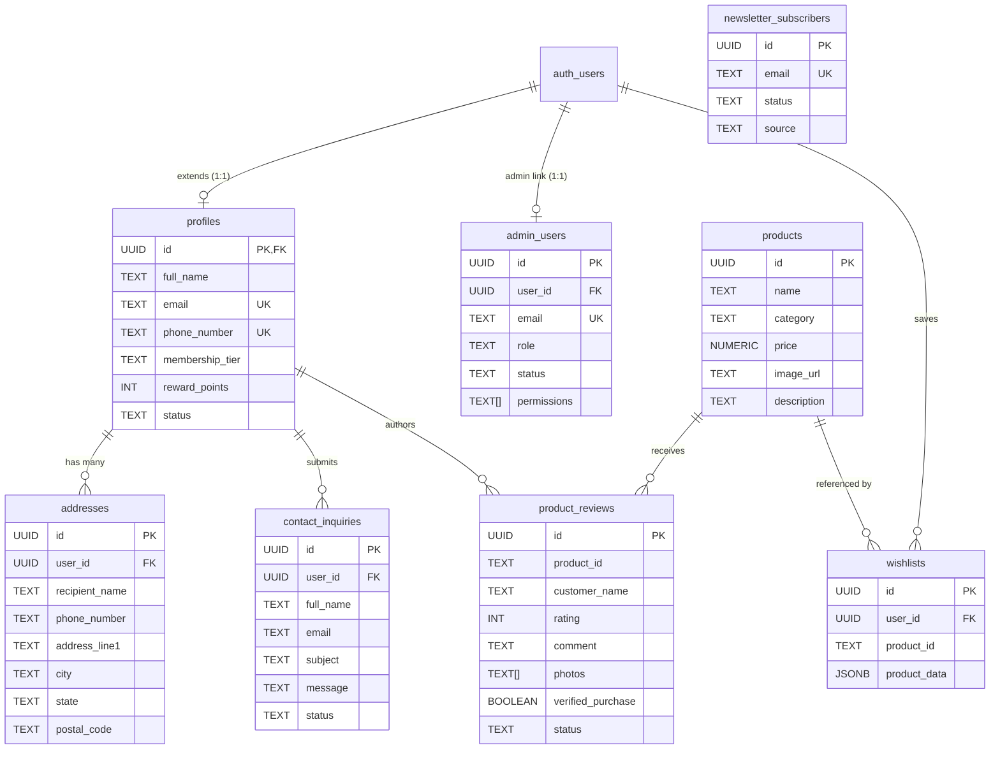

# Avsaraa Admin Capabilities & Database Architecture Guide

This document details all data and operational permissions available to the **Avsaraa Super Administrator** across Read, Create, Write (Update), and Delete operations, followed by a complete reference of all database tables, columns, constraints, and Row Level Security (RLS) policies.

---

## Part 1: Administrative Capabilities Matrix

The Avsaraa admin dashboard ([/admin](file:///home/lord-kratos/WORK/D/Avsaraa/src/app/admin/page.tsx)) is guarded by timing-safe authentication, IP rate limiting, and server-side authorization checks ([src/lib/adminAuth.ts](file:///home/lord-kratos/WORK/D/Avsaraa/src/lib/adminAuth.ts)).

### Operational Summary Matrix

| Category / Domain | Read / View | Create | Write (Update) | Delete | API Endpoint |
| :--- | :---: | :---: | :---: | :---: | :--- |
| **1. Products Catalog** | ✅ Full Catalog & Stats | ✅ Add New Product | ✅ Update Price, Text, Image | ✅ Delete Product | [`/api/admin/products`](file:///home/lord-kratos/WORK/D/Avsaraa/src/app/api/admin/products/route.ts) |
| **2. Customer Accounts** | ✅ Profiles, Tiers, Points | ✅ Add Profile Manually | ✅ Edit Status, Tier, Points | ✅ Delete Profile | [`/api/admin/users`](file:///home/lord-kratos/WORK/D/Avsaraa/src/app/api/admin/users/route.ts) |
| **3. Patron Reviews** | ✅ Ratings, Text, Media | 🌐 Storefront Submissions | ✅ Moderate Status, Verified Badge | ✅ Delete Review | [`/api/admin/reviews`](file:///home/lord-kratos/WORK/D/Avsaraa/src/app/api/admin/reviews/route.ts) |
| **4. Inquiries & Concierge** | ✅ Customer Messages | 🌐 Contact Form Submissions | ✅ Progress Status Workflow | ✅ Delete Inquiry | [`/api/admin/inquiries`](file:///home/lord-kratos/WORK/D/Avsaraa/src/app/api/admin/inquiries/route.ts) |
| **5. Newsletter Subscribers**| ✅ Subscriber Emails & Dates | 🌐 Footer Subscription | — | ✅ Remove Email | [`/api/admin/inquiries`](file:///home/lord-kratos/WORK/D/Avsaraa/src/app/api/admin/inquiries/route.ts) |
| **6. Super Admin Master** | ✅ Profile, Role, Logs | 🚫 Blocked (Single Authority) | ✅ Edit Name, Department, Phone | 🚫 Protected (Cannot Delete) | [`/api/admin/auth`](file:///home/lord-kratos/WORK/D/Avsaraa/src/app/api/admin/auth/route.ts) |
| **7. Customer Addresses** | ✅ Admin Bypass for Orders | 👤 Managed by Customer | 👤 Managed by Customer | 👤 Managed by Customer | Direct DB RLS |
| **8. Customer Wishlists** | ✅ Admin Analytics & Auditing | 👤 Saved by Patron | — | 👤 Managed by Patron | Direct DB RLS |

---

### Category Breakdown & Available Fields

#### 1. Products Catalog (`products`)
* **Read**:
  * Product ID (UUID), Product Name, Category (`Sarees`, `Dresses`, `New Arrivals`, `Occasion Wear`).
  * Price in ₹ INR, Image URL, Atelier fabric & craftsmanship description.
  * Search by title/keywords and filter by category tab.
* **Create**:
  * Add new luxury handloom sarees or couture silhouettes with Name, Category, Price, Image URL, and Description.
* **Write (Update)**:
  * Modify pricing, title, category reassignment, high-resolution imagery, and product descriptions in real time.
* **Delete**:
  * Permanently purge deprecated or discontinued catalog items.

#### 2. Customer Accounts (`profiles`)
* **Read**:
  * Profile ID, Full Name, Email, Normalized Mobile Number (E.164 with country code).
  * Account Status (`Active`, `Inactive`, `Suspended`).
  * Membership Tier (`Standard`, `Privilege`, `Atelier Circle`, `VIP`).
  * Loyalty Reward Points balance (`reward_points`), joined date, and last activity timestamps.
* **Create**:
  * Manually onboard or register customer profiles with customized tier and welcome reward points.
* **Write (Update)**:
  * Suspend, freeze, or restore customer accounts.
  * Elevate membership tiers (`Standard` ➔ `Privilege` ➔ `Atelier Circle` ➔ `VIP`).
  * Adjust loyalty reward points balance.
  * Update phone numbers (enforces database uniqueness checks to prevent duplicate accounts).
* **Delete**:
  * Remove customer profiles from the database.

#### 3. Patron Reviews & Media (`product_reviews`)
* **Read**:
  * Review ID, Product ID, Product Name, Customer Name, Email, City.
  * Star Rating (1 to 5 stars), Review Title, Detailed customer review text.
  * Customer-uploaded photos with high-resolution preview lightbox.
  * Filter reviews by `ALL`, `WITH_MEDIA`, `5_STAR`, or `FLAGGED`.
* **Create**:
  * Generated primarily by patrons on the storefront or seeded via database scripts ([dummy.sql](file:///home/lord-kratos/WORK/D/Avsaraa/supabase/dummy.sql)).
* **Write (Update)**:
  * Moderate status: `published`, `pending`, `hidden`, or `flagged`.
  * Toggle the **Verified Purchase** badge (`verified_purchase: true/false`).
* **Delete**:
  * Permanently remove spam, abusive, or obsolete reviews.

#### 4. Bespoke Inquiries & VIP Concierge (`contact_inquiries` & `newsletter_subscribers`)
* **Read**:
  * **Inquiries**: Full Name, Email, Phone Number, Subject, Message Body, Received Timestamp, Status.
  * **Subscribers**: Subscribed email address, source (`Website Footer`), and subscription timestamp.
* **Create**:
  * Created by visitors via the storefront `/contact` form and newsletter bar.
* **Write (Update)**:
  * Advance inquiry lifecycle status: `Unread` ➔ `In Progress` ➔ `Resolved` ➔ `Archived`.
* **Delete**:
  * Delete resolved/obsolete contact inquiries.
  * Unsubscribe or delete emails from the newsletter distribution list.

#### 5. Super Admin Governance (`admin_users`)
* **Read**:
  * Master profile details: Full Name, Email, Role (`Super Admin`), Department, Phone, Active Permissions list, and Last Active timestamp.
* **Create**:
  * **Intentionally Blocked**: Avsaraa operates strictly under a single Super Admin authority. Creating secondary admin accounts is blocked by API policy to prevent privilege escalation.
* **Write (Update)**:
  * Update contact name, department, phone number, and internal administrative notes.
* **Delete**:
  * **Intentionally Blocked**: The root Super Admin account cannot be deleted to eliminate accidental lockout risks.

---

## Part 2: Database Schema & Table Architecture

The Avsaraa database runs on PostgreSQL via Supabase, with full **Row Level Security (RLS)** active across every table.

---

### Detailed Table Specifications

#### Table 1: `public.admin_users`
Stores credentials and permissions for the master administrative authority.

| Column | Data Type | Constraints & Defaults | Description |
| :--- | :--- | :--- | :--- |
| `id` | `UUID` | `PRIMARY KEY DEFAULT gen_random_uuid()` | Unique administrator record ID |
| `user_id` | `UUID` | `REFERENCES auth.users(id) ON DELETE SET NULL` | Linked Supabase Auth user ID |
| `full_name` | `TEXT` | `NOT NULL` | Super Admin's display name |
| `email` | `TEXT` | `UNIQUE NOT NULL` | Master admin login email |
| `role` | `TEXT` | `NOT NULL DEFAULT 'Super Admin'` | Checked to equal `'Super Admin'` |
| `department` | `TEXT` | `DEFAULT 'Executive Leadership'` | Executive department |
| `phone_number` | `TEXT` | Nullable | Admin direct telephone |
| `avatar_url` | `TEXT` | Nullable | Profile avatar image URL |
| `status` | `TEXT` | `DEFAULT 'Active' CHECK IN ('Active', 'Inactive', 'Suspended')` | Administrative access status |
| `permissions` | `TEXT[]` | `DEFAULT ARRAY['all:super_admin', ...]` | Master capabilities array |
| `notes` | `TEXT` | Nullable | Internal security notes |
| `last_active` | `TIMESTAMPTZ` | `DEFAULT TIMEZONE('utc', NOW())` | Timestamp of last activity |
| `created_at` | `TIMESTAMPTZ` | `DEFAULT TIMEZONE('utc', NOW()) NOT NULL` | Record creation date |
| `updated_at` | `TIMESTAMPTZ` | `DEFAULT TIMEZONE('utc', NOW()) NOT NULL` | Last update date |

> [!NOTE]
> **RLS Policies**: Select, Insert, and Update require `public.is_admin() = true`. Deletion is disallowed by policy.

---

#### Table 2: `public.profiles`
Extends `auth.users` to maintain customer profiles, phone numbers, and loyalty tiers.

| Column | Data Type | Constraints & Defaults | Description |
| :--- | :--- | :--- | :--- |
| `id` | `UUID` | `PRIMARY KEY REFERENCES auth.users(id) ON DELETE CASCADE` | 1-to-1 match with Supabase Auth |
| `full_name` | `TEXT` | `NOT NULL` | Patron full name |
| `phone_number` | `TEXT` | Partial unique index (`idx_profiles_phone_number_unique`) | E.164 verified phone number |
| `email` | `TEXT` | `UNIQUE` | User email address |
| `avatar_url` | `TEXT` | Nullable | Customer profile image |
| `status` | `TEXT` | `DEFAULT 'Active' CHECK IN ('Active', 'Inactive', 'Suspended')` | Account status |
| `membership_tier` | `TEXT` | `DEFAULT 'Standard' CHECK IN ('Standard', 'Privilege', 'Atelier Circle', 'VIP')` | Loyalty membership tier |
| `reward_points` | `INTEGER` | `DEFAULT 0 CHECK (reward_points >= 0)` | Accrued reward points |
| `preferred_currency` | `TEXT` | `DEFAULT 'INR'` | Display currency preference |
| `created_at` | `TIMESTAMPTZ` | `DEFAULT TIMEZONE('utc', NOW()) NOT NULL` | Account registration time |
| `updated_at` | `TIMESTAMPTZ` | `DEFAULT TIMEZONE('utc', NOW()) NOT NULL` | Last profile update |

> [!IMPORTANT]
> **Security Trigger (`protect_profile_fields`)**: Automatically rejects non-admin attempts to tamper with `membership_tier`, `reward_points`, or `status`.

---

#### Table 3: `public.addresses`
Delivery locations saved by patrons for express checkout.

| Column | Data Type | Constraints & Defaults | Description |
| :--- | :--- | :--- | :--- |
| `id` | `UUID` | `PRIMARY KEY DEFAULT gen_random_uuid()` | Address identifier |
| `user_id` | `UUID` | `NOT NULL REFERENCES public.profiles(id) ON DELETE CASCADE` | Owner profile |
| `address_type` | `TEXT` | `DEFAULT 'Home' CHECK IN ('Home', 'Work', 'Studio', 'Other')` | Label for destination |
| `recipient_name` | `TEXT` | `NOT NULL` | Name of person receiving package |
| `phone_number` | `TEXT` | `NOT NULL` | Courier contact number |
| `address_line1` | `TEXT` | `NOT NULL` | Flat / House / Street |
| `address_line2` | `TEXT` | Nullable | Locality / Sector |
| `landmark` | `TEXT` | Nullable | Prominent nearby location |
| `city` | `TEXT` | `NOT NULL` | Destination city |
| `state` | `TEXT` | `NOT NULL` | Destination state |
| `postal_code` | `TEXT` | `NOT NULL` | Postal PIN code |
| `country` | `TEXT` | `DEFAULT 'India' NOT NULL` | Destination country |
| `is_default` | `BOOLEAN` | `DEFAULT false` | Primary delivery location flag |
| `created_at` | `TIMESTAMPTZ` | `DEFAULT TIMEZONE('utc', NOW()) NOT NULL` | Record creation date |
| `updated_at` | `TIMESTAMPTZ` | `DEFAULT TIMEZONE('utc', NOW()) NOT NULL` | Record modification date |

> [!NOTE]
> **RLS Policies**: Patrons have full CRUD on their own addresses (`auth.uid() = user_id`). Admins have SELECT access for order processing.

---

#### Table 4: `public.products`
The luxury handloom and couture inventory catalog.

| Column | Data Type | Constraints & Defaults | Description |
| :--- | :--- | :--- | :--- |
| `id` | `UUID` | `PRIMARY KEY DEFAULT gen_random_uuid()` | Unique product identifier |
| `name` | `TEXT` | `NOT NULL` | Product title |
| `category` | `TEXT` | `NOT NULL CHECK IN ('Sarees', 'Dresses', 'New Arrivals', 'Occasion Wear')` | Product category |
| `price` | `NUMERIC(10,2)`| `NOT NULL CHECK (price >= 0)` | Price in ₹ INR |
| `image_url` | `TEXT` | `NOT NULL` | Primary showcase photography URL |
| `description` | `TEXT` | Nullable | Weave, zari, and silhouette details |
| `user_id` | `UUID` | `REFERENCES auth.users(id) ON DELETE SET NULL` | Creator ID |
| `created_at` | `TIMESTAMPTZ` | `DEFAULT TIMEZONE('utc', NOW()) NOT NULL` | Inventory addition date |

> [!NOTE]
> **RLS Policies**: Anyone (including public visitors) can SELECT (`true`). Only Super Admin can INSERT, UPDATE, or DELETE (`public.is_admin()`).

---

#### Table 5: `public.contact_inquiries`
Client concierge queries, bespoke requests, and contact messages.

| Column | Data Type | Constraints & Defaults | Description |
| :--- | :--- | :--- | :--- |
| `id` | `UUID` | `PRIMARY KEY DEFAULT gen_random_uuid()` | Inquiry identifier |
| `user_id` | `UUID` | `REFERENCES public.profiles(id) ON DELETE SET NULL` | Linked patron profile (if logged in) |
| `full_name` | `TEXT` | `NOT NULL` | Inquirer full name |
| `email` | `TEXT` | `NOT NULL` | Inquirer email |
| `phone_number` | `TEXT` | Nullable | Contact phone number |
| `subject` | `TEXT` | `NOT NULL` | Inquiry topic |
| `message` | `TEXT` | `NOT NULL` | Message body |
| `status` | `TEXT` | `DEFAULT 'Unread' CHECK IN ('Unread', 'In Progress', 'Resolved', 'Archived')` | Concierge processing status |
| `created_at` | `TIMESTAMPTZ` | `DEFAULT TIMEZONE('utc', NOW()) NOT NULL` | Submission timestamp |

> [!NOTE]
> **RLS Policies**: Anyone can INSERT (`true`). Super Admin can SELECT, UPDATE, and DELETE all inquiries. Patrons can view their own inquiries.

---

#### Table 6: `public.newsletter_subscribers`
Patrons subscribed to receive seasonal updates, private previews, and atelier news.

| Column | Data Type | Constraints & Defaults | Description |
| :--- | :--- | :--- | :--- |
| `id` | `UUID` | `PRIMARY KEY DEFAULT gen_random_uuid()` | Subscriber record ID |
| `email` | `TEXT` | `UNIQUE NOT NULL` | Subscriber email address |
| `status` | `TEXT` | `DEFAULT 'Subscribed' CHECK IN ('Subscribed', 'Unsubscribed')` | Subscription state |
| `source` | `TEXT` | `DEFAULT 'Website Footer'` | Signup origin |
| `created_at` | `TIMESTAMPTZ` | `DEFAULT TIMEZONE('utc', NOW()) NOT NULL` | Subscription timestamp |

> [!NOTE]
> **RLS Policies**: Anyone can INSERT (`true`). Only Super Admin can SELECT and DELETE (`public.is_admin()`).

---

#### Table 7: `public.wishlists`
Heirlooms saved to customer accounts for future acquisition.

| Column | Data Type | Constraints & Defaults | Description |
| :--- | :--- | :--- | :--- |
| `id` | `UUID` | `PRIMARY KEY DEFAULT gen_random_uuid()` | Wishlist item ID |
| `user_id` | `UUID` | `NOT NULL REFERENCES auth.users(id) ON DELETE CASCADE` | Saved by customer |
| `product_id` | `TEXT` | `NOT NULL` | Target product identifier |
| `product_data` | `JSONB` | Nullable | Cached product snapshot for fast rendering |
| `created_at` | `TIMESTAMPTZ` | `DEFAULT TIMEZONE('utc', NOW()) NOT NULL` | Date saved to wishlist |
| — | `CONSTRAINT` | `UNIQUE (user_id, product_id)` | Prevents duplicate wishlist items |

> [!NOTE]
> **RLS Policies**: Users have full CRUD on their own wishlist (`auth.uid() = user_id`). Admins have SELECT access for concierge recommendations.

---

#### Table 8: `public.product_reviews`
Customer reviews, ratings, and photographic testimonials.

| Column | Data Type | Constraints & Defaults | Description |
| :--- | :--- | :--- | :--- |
| `id` | `UUID` | `PRIMARY KEY DEFAULT gen_random_uuid()` | Review identifier |
| `product_id` | `TEXT` | `NOT NULL` | Reviewed product ID |
| `product_name` | `TEXT` | Nullable | Product name at time of review |
| `user_id` | `UUID` | `REFERENCES auth.users(id) ON DELETE SET NULL` | Reviewer user account |
| `customer_name`| `TEXT` | `NOT NULL` | Author display name |
| `customer_email`| `TEXT` | Nullable | Reviewer contact email |
| `customer_city`| `TEXT` | Nullable | Customer location |
| `rating` | `INTEGER` | `NOT NULL CHECK (rating >= 1 AND rating <= 5)` | Rating from 1 to 5 stars |
| `title` | `TEXT` | Nullable | Review heading |
| `comment` | `TEXT` | `NOT NULL` | Testimonial text |
| `photos` | `TEXT[]` | `DEFAULT '{}'` | Array of uploaded photo URLs |
| `verified_purchase` | `BOOLEAN` | `DEFAULT false` | Verified purchase indicator |
| `helpful_count`| `INTEGER` | `DEFAULT 0` | Patron helpful upvotes |
| `status` | `TEXT` | `DEFAULT 'published' CHECK IN ('published', 'pending', 'hidden', 'flagged')` | Moderation status |
| `created_at` | `TIMESTAMPTZ` | `DEFAULT TIMEZONE('utc', NOW()) NOT NULL` | Submission timestamp |
| `updated_at` | `TIMESTAMPTZ` | `DEFAULT TIMEZONE('utc', NOW()) NOT NULL` | Moderation timestamp |

> [!IMPORTANT]
> **Security Trigger (`protect_review_fields`)**: Public submissions cannot set `verified_purchase: true` or inflate `helpful_count`. Only Super Admin can verify purchases or moderate status.

---

## Part 3: Security & Governance Functions

1. **`public.is_admin()`**:
   * Evaluates if the current JWT belongs to the Super Admin via email matching, role checks (`app_metadata->>'role' = 'super_admin'`), or active status in `admin_users`.
2. **`public.handle_new_user()`**:
   * Automatic trigger executed on `auth.users` insertion. Extracts full name, phone number, and avatar (supporting Email + Password and Google OAuth), creating an initial profile with 100 reward points.
3. **`public.protect_profile_fields()`**:
   * Guards against privilege escalation on `profiles` updates.
4. **`public.protect_review_fields()`**:
   * Guards against fraudulent reviews claiming verified purchase status without admin approval.
5. **`public.check_phone_exists(phone, user_id)` & `public.check_email_exists(email, user_id)`**:
   * Helper functions preventing account duplication.
